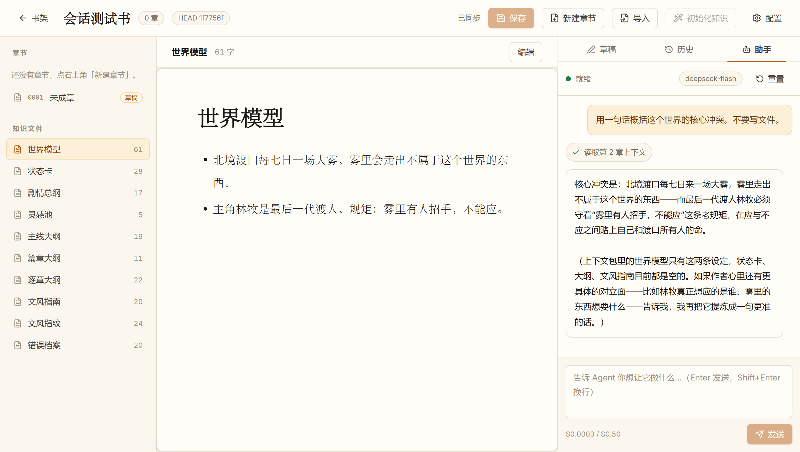

# Novel Studio

[](https://github.com/JeffGuo7/novel_studio/actions/workflows/ci.yml)

本地优先的小说创作工作台。**每一章都有版本，AI 草稿永远污染不了正史。**

Electron + React + TypeScript + isomorphic-git + **pi agent SDK**。
Markdown 是唯一真相，Git 管正史，草稿走独立轻量版本库，Agent 跑在独立 `utilityProcess` 里。
界面是**明亮纸感**风格：暖纸底、琥珀强调、文学衬线标题，图标全部为 lucide SVG 组件（不使用 emoji）。





## 当前状态（v0.12 · 三种导入 + 知识库 + Agent 轨迹/预算预警 + 可分发安装包）

已实现并跑通（含 Electron 端到端、打包产物端到端）：

- 书架：建书 / 列出 / 打开
- 章节：新建、编辑、保存（每次保存一个 Git 提交）
- **导入**：三种入口——粘贴文本、本地多文件、番茄书源（需本机下载器）；自动识别 UTF-8 / GB18030，按「第 N 章」切分，一次提交
- **知识库初始化**：导入后一键把章节蒸馏成剧情总纲 / 世界模型 / 状态卡 / 逐章大纲 / **文风指南 + 文风指纹**（分块 + 合并，一次提交，可取消）
- **知识库增量更新**：写新章节后按钮变「更新知识 (N)」，只蒸馏新增章节、合并进已有知识并滚动状态卡
- **失效检测与重建**：给每章记内容 hash，已归档章节被改写/删除时按钮变「重建知识」，避免知识库引用过时设定
- **文风指纹**：本地统计平均句长 / 段长 / 对话占比 / 人称 / 高频意象，模型只做一次解读；Agent 续写时上下文里带文风约束
- 知识文件：世界观 / 状态卡 / 剧情总纲 / 四层大纲 / 文风 / 错误档案，可编辑提交
- 草稿：多版本保留、任意版本查看、以旧版为基线继续写、归档成章、整章丢弃
- 历史：提交时间线、词级 diff、回滚（生成新提交，历史不丢失）
- 状态从文件系统推导，没有独立状态库
- **Agent（pi 基座）**：读上下文包 → 写草稿版本 → UI 自动跳转；支持中断 / 插话 / 成本统计；
  工具层只有「读」和「写草稿」，**没有归档权限**
- **模型配置**：内置 pi 的完整模型目录（41 个 provider / 1599 个模型），也支持自定义
  OpenAI 兼容 endpoint；密钥用系统 safeStorage 加密存在本机
- **会话持久化**：Agent 对话存在书库 `.studio/agent/session.json`，重启自动恢复并**在 UI 里还原成对话气泡**
- **成本熔断**：会话预算（默认 $0.50/本）+ 单章预算（默认 $0.20/章），超限自动停止并封锁输入，重启不能绕过
- **明亮 UI**：暖纸 + 琥珀主题、自托管字体（Inter / Cormorant Garamond）、Lucide SVG 图标
- **打包/分发**：`npm run release` 一条命令出 NSIS 安装包 + 便携版 + SHA256 校验和 + 发行说明；未签名（README 写明运行方式）
- **诊断信息**：配置弹窗底部显示版本/Electron/Node、书库与配置路径，可一键打开目录

未实现（下一步）：

- 在线书源直连（目前依赖本机下载器，不自带抓取）
- 自动更新（需要仓库公开或自建更新服务）
- 代码签名（开源免费渠道可申请，见 docs/release.md）

## 快速开始

```powershell
npm install
copy .env.example .env.local   # 可选：也可以启动后在「本机配置」里填 key
npm run dev                    # 开发模式（热更新）
npm run build                  # 生产构建
npm test                       # 单测（core + Agent faux provider，不烧 token）
npm run typecheck              # 类型检查
npm run e2e:agent              # 真实模型端到端（需要 key，会消耗少量 token）

npm run dist:dir               # 打包成解包目录（release/win-unpacked）
npm run dist                   # 打包成 Windows 安装包
```

书库默认位置：系统「文档」目录下的 `NovelStudio/`；可用环境变量 `NOVEL_STUDIO_HOME` 覆盖。
模型和密钥在应用右上角「本机配置」里设置，默认 `deepseek-flash`。

> ⚠️ 如果你的环境里设置了 `ELECTRON_RUN_AS_NODE=1`，Electron 会退化成纯 Node 进程
> （`app` 为 undefined，但 `process.versions.electron` 仍在，极容易误判）。启动前清掉它。

## 目录结构

```text
novel_studio/
├── src/
│   ├── core/            # 纯 TS 领域层：书库、GitPort、草稿版本（可单测，不依赖 Electron）
│   ├── agent/           # pi 基座：Agent 循环、工具、utilityProcess host
│   ├── main/            # Electron 主进程：窗口 + IPC 路由 + AgentManager
│   ├── preload/         # contextBridge，暴露 window.studio
│   ├── renderer/        # React 工作台（书架 + 三栏）
│   └── shared/          # 主/渲染共用的类型与 IPC 契约
├── tests/               # vitest：真实 git 仓库，不 mock
├── scripts/             # 构建 Agent、生成模型目录、三种 e2e（源码/真实模型/打包产物）
├── build/               # 打包图标等构建资源
├── electron-builder.yml # 打包配置（NSIS）
└── docs/                # 设计定稿、Agent 层、Git/打包方案、参考项目评审
```

## 文档

- [设计定稿](docs/design.md)：数据布局、版本模型、状态机、IPC 协议
- [Agent 层设计](docs/agent.md)：进程边界、工具权限、事件协议、模型与密钥
- [UI 设计规范](docs/ui-design.md)：明亮纸感主题、颜色/字体/图标/动效与可达性
- [知识库管线](docs/knowledge-pipeline.md)：全量/增量蒸馏、文风指纹、提示词约束、上限与成本
- [导入](docs/import.md)：粘贴 / 批量文件 / 番茄书源适配、编码与切章规则
- [构建与分发](docs/release.md)：release 流程、校验和、未签名说明、签名与自动更新路线
- [打包与分发](docs/packaging.md)：electron-builder 配置、asar 边界、已知限制
- [Git 方案选型](docs/git-strategy.md)：isomorphic-git 实测基准与决策
- [Electron + pi 可行性](docs/feasibility-electron-pi.md)：技术栈验证与 POC 计划
- [参考项目评审](docs/reference-review.md)：值得抄的设计与必须避开的坑

## 已踩过的平台坑（都已在代码里处理）

| 坑 | 现象 | 处理 |
|---|---|---|
| Node 24 + Windows 非 ASCII 路径 | `fs.rmSync` 静默不删，甚至 fail-fast 崩溃 | 用 `unlinkSync`/`rmdirSync` 自实现 `removeDirRecursive` |
| isomorphic-git `statusMatrix` | 同长度、同秒内的修改被判为「未变化」，提交丢失 | 写入方显式给出变更路径 + `force: true` 提交，不靠扫描 |
| `ELECTRON_RUN_AS_NODE=1` | Electron 变成 Node，`app` 为 undefined | 启动前清除该变量（e2e 脚本已处理） |
| ESM 里打包 CJS 依赖 | `Dynamic require of "buffer" is not supported` | esbuild banner 注入 `createRequire`（`scripts/build-agent.mjs`） |

## 设计红线

1. AI 只能写草稿层，正史只接受人工确认的归档；
2. 一次归档 = 一个 commit，多文件原子；
3. 回滚不改写历史，只追加新提交；
4. 草稿不进 Git 历史，书库随时可以用任意 Git 工具接管。
