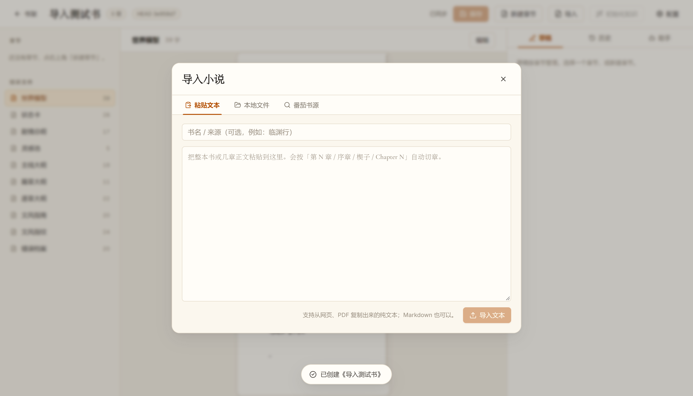

# 导入（粘贴 / 批量文件 / 在线书源）

三种入口都复用同一套核心逻辑：解码 → 切章 → 写 `chapters/NNNN_标题.md` → 一次 `[导入]` 提交。

## 1. 入口

工作台顶栏「导入」打开弹窗，三个标签页：

| 标签 | 说明 |
|---|---|
| 粘贴文本 | 整本或几章正文粘贴进来，按标题自动切章；书名/来源可选 |
| 本地文件 | 多选 txt / md，一次导入合成一个提交（按文件名排序） |
| 番茄书源 | 连接本机的番茄下载器（Tomato-Novel-Downloader），搜索并导入 |



## 2. 番茄书源适配

**不直接抓取外部站点**，只连接用户本机运行的下载器：

```text
GET  /api/status          探测（默认 127.0.0.1:18423）
GET  /api/search?q&count  搜索
POST /api/config          设置保存目录 / txt 格式
POST /api/jobs {book_id}  提交下载
GET  /api/jobs            轮询进度（items[].state: done / failed）
```

- 检测不到时，弹窗给出说明，不影响粘贴/文件导入；
- 可设置环境变量 `NOVEL_STUDIO_TOMATO_EXE`（或 `TOMATO_DOWNLOADER_EXE`）指向下载器 exe，
  应用会尝试以 `--server` 模式自动拉起，并轮询等待就绪；
- 下载完成后读取生成的 txt，走本地导入管线，然后清理临时目录。


这样做的原因：第三方站点的直连抓取不稳定、也有合规风险；而"用户自己的下载器 + 本地文件"边界清晰，
下载器升级或接口变化时也不影响应用本体。

## 3. 编码与切章

- 解码：优先 UTF-8；出现替换字符时回退 GB18030（番茄下载的 txt 常见）；
- 切章：`第 N 章 / 序章 / 楔子 / Chapter N` 等标题行；没有标题时整段成章；
- 标题里的空格会保留在文件名里（`0001_第一章 雾夜渡客.md`），回读标题与原样一致。

## 4. 批量导入

`importSourcesIntoBook` 把多个文本源合并处理：

- 每个源内部切章，章节编号跨源连续递增；
- 所有章节写入后生成 **一个** 提交：`[导入] 导入 N 章 · a.txt、b.txt`；
- 报告里带 `sources` 数量，UI 提示"N 章（M 个文件）"。

## 5. 代码位置

| 文件 | 作用 |
|---|---|
| `src/core/import.ts` | 解码、切章、`importSourcesIntoBook` / `importFileIntoBook` / `importManyFilesIntoBook` |
| `src/main/tomato-client.ts` | 下载器 HTTP 客户端（探测/搜索/下载，纯 Node，可 stub 测试） |
| `src/main/tomato-manager.ts` | 探测 + 自动拉起 exe + 下载后导入编排 |
| `src/renderer/src/components/ImportModal.tsx` | 三个导入入口的 UI |
| `tests/import.test.ts` | 11 个用例（切章、编码、单文件、批量、空文件） |
| `tests/tomato-client.test.ts` | 5 个用例（探测、搜索归一化、下载轮询、失败处理；本地 stub server） |
| `scripts/e2e-import-ui.mjs` | UI 端到端：粘贴 3 章 → 批量 2 文件 → 番茄未安装提示 |
